<p align="center">
  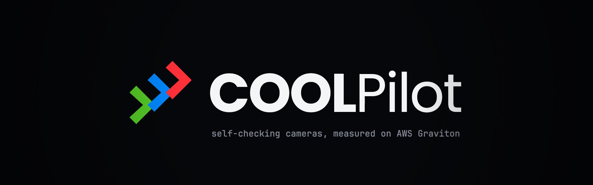
</p>

<div align="center">
  <h1>COOLPilot</h1>
  <p><strong>Camera health for ADAS fleets. OpenCV 5 checks every frame against that camera's own normal, an agent verifies before an alarm stands, and an autopilot tunes it all, with nothing shipped without proof.</strong></p>
  <p><em>A dirty lens doesn't crash. It quietly lies. COOLPilot catches it.</em></p>
  <p>
    <a href="submission/submission-description.md"></a>
    <a href="https://opencv26.devpost.com/"></a>
    <a href="https://n7ebpehiuh2hczk2uzsherigia0pyqfg.lambda-url.us-east-1.on.aws/"></a>
  </p>
  <p>
    <a href="LICENSE"></a>
    
    
    
    
    
  </p>
  <p>
    
    
    
    
    
    
  </p>
  <p>
    <a href="submission/submission-description.md">Submission</a> ·
    <a href="docs/TECHNICAL_REPORT.md">Technical report</a> ·
    <a href="docs/AGENT_WORKFLOW.md">Agent workflow</a> ·
    <a href="docs/COOL.md">COOL on Graviton</a> ·
    <a href="docs/BEFORE_AFTER.md">Before/after record</a> ·
    <a href="video/coolpilot_showreel_upload.mp4">Showreel</a>
  </p>
  <p><sub>Every frame → 16 OpenCV tiles vs this camera's normal → suspicion → the agent measures → dismiss · keep · ask a human</sub></p>
</div>

> [!IMPORTANT]
> COOLPilot is a **research workbench**, not a safety system, and it is not validated for driving decisions. All faults in the evidence are synthetic, except DRIVE-C's independent corruptions. Lens dirt is not solved. Every number below comes from a file in `docs/evidence/`, and failures are reported as measured (see [Truth boundaries](#truth-boundaries)).

<details>
<summary><kbd>Contents</kbd></summary>

- [At a glance](#-at-a-glance)
- [The problem](#the-problem)
- [The COOLPilot loop](#-the-coolpilot-loop)
- [See the product](#see-the-product)
- [Results](#-results)
- [OpenCV 5, measured](#opencv-5-measured)
- [COOL on AWS Graviton](#cool-on-aws-graviton)
- [The autopilot, and why nothing ships without proof](#the-autopilot-and-why-nothing-ships-without-proof)
- [How the system is built](#how-the-system-is-built)
- [Run locally](#-run-locally)
- [Verify](#verify)
- [Truth boundaries](#truth-boundaries)
- [Repository map](#repository-map)
- [License and attribution](#license-and-attribution)

</details>

## 🚘 At a glance

<table>
  <tr>
    <td width="25%" align="center"><strong>01 / SEE</strong><br><br>Every frame, every camera. OpenCV 5 splits it into 16 tiles and measures detail, brightness, clipping and motion.</td>
    <td width="25%" align="center"><strong>02 / COMPARE</strong><br><br>Against <em>this</em> camera's own normal, learned while healthy. A bright sky is normal; a sudden one is not.</td>
    <td width="25%" align="center"><strong>03 / VERIFY</strong><br><br>A suspicion triggers more OpenCV 5 tools: texture, NanoDet on the new DNN engine, optical flow. Dismiss, keep, or ask a human.</td>
    <td width="25%" align="center"><strong>04 / PROVE</strong><br><br>The autopilot proposes changes; validation on never-seen clips and a human decide. Two of its proposals were rejected.</td>
  </tr>
</table>

<p align="center">
  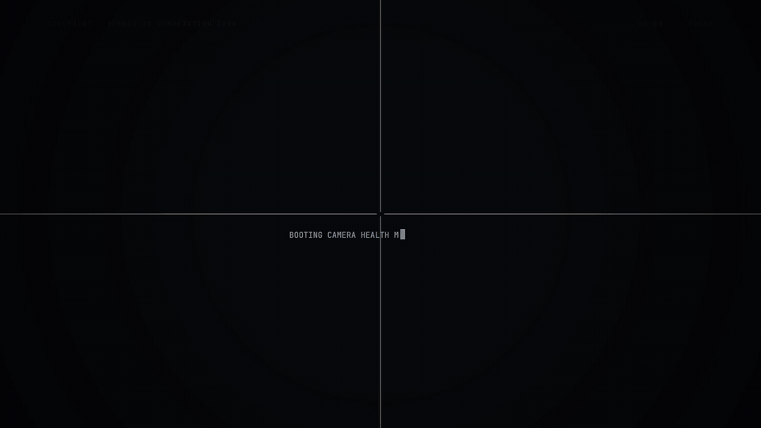
</p>

## The problem

A camera on a car rarely fails loudly. A smear, a glare, a dark tunnel or a frozen frame still delivers frames, so everything downstream keeps trusting them.

The obvious fix is fixed thresholds, and they misfire on real roads:
- A bright sky is always "clipped", so glare fires constantly.
- A passing building makes the road look "obstructed".

Our own starting point failed **15 of 53** checks at **1,332 false alarms per hour**.

<p align="center">
  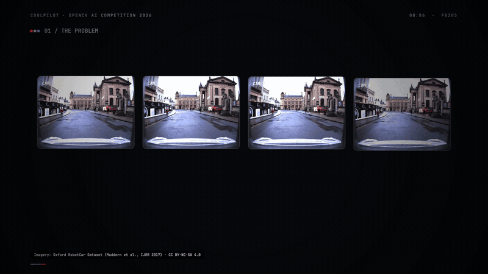
</p>

COOLPilot asks a narrower question:

> Can every camera be checked against its *own* normal, frame by frame, and can an alarm be trusted because something measured it twice?

## ✨ The COOLPilot loop

<p align="center">
  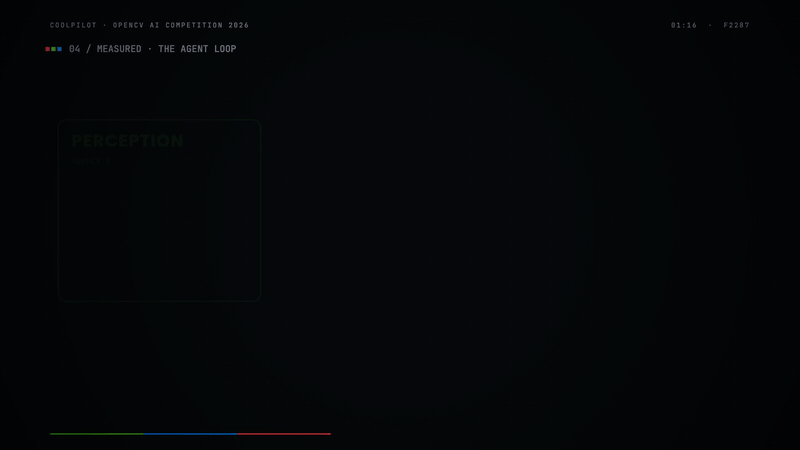
</p>

| Stage | What happens | What cannot happen silently |
| --- | --- | --- |
| **Perceive** | Each frame is resized (`INTER_AREA`), converted (`cvtColor`) and split into 4×4 tiles. Detail (`Laplacian` variance via `meanStdDev`), brightness, clipping (`compare` + `countNonZero`) and freeze (`absdiff`) are measured at 640 px. | Delivery health (late, missing frames) is judged separately from image health; a late frame is not called a bad one. |
| **Compare** | Each tile is held against references learned only while the view is healthy. Hysteresis and persistence stop flicker. | A fault is never absorbed into "normal": references freeze while anything is pending. |
| **Verify** | A suspected obstruction runs `inspect_texture` (HSV sky/texture), `detect_road_users` (NanoDet on **`cv2.dnn` ENGINE_NEW**) and `measure_motion` (Farneback flow). | Deciding before measuring is refused. Any tool or provider error **keeps** the alarm. |
| **Act** | **Dismiss** (the scene, not the lens), **keep**, or **escalate** to a human, who sees Confirm / Dismiss. | Every verdict is logged with its reason, tools and latency, and emitted to CloudWatch. |

<p align="center">
  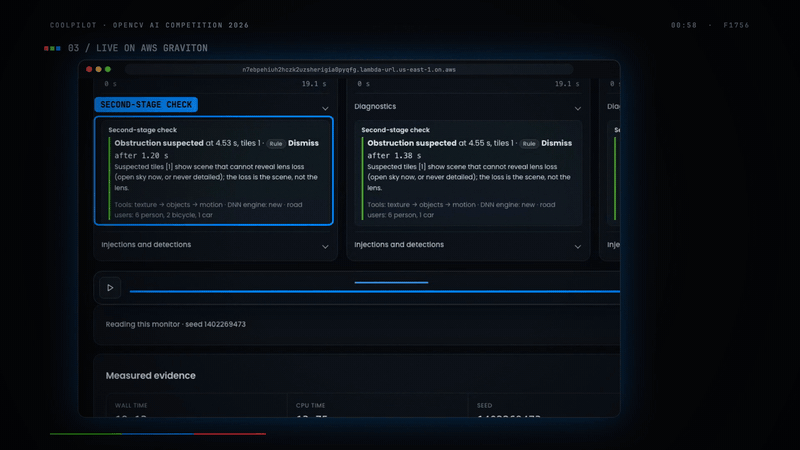
</p>

## See the product

Every screenshot and clip is a recording of the **deployed app on AWS Lambda (arm64)**. Road imagery: Oxford RobotCar. Uploaded clips: DRIVE-C (see [attribution](#license-and-attribution)).

<table>
  <tr>
    <td width="50%">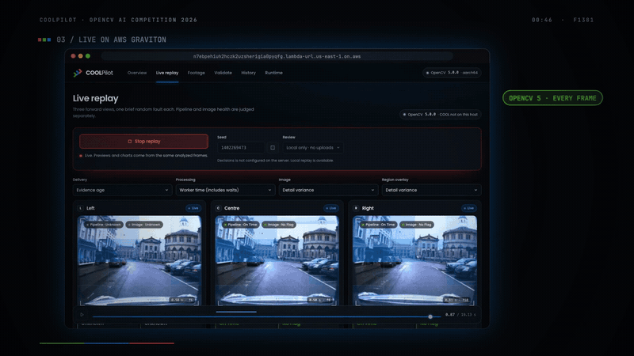<br><sub><strong>Live replay.</strong> Three cameras paced to their real sensor timestamps; glare flagged on the centre one; pipeline on time, result age ≤ 0.25 s.</sub></td>
    <td width="50%">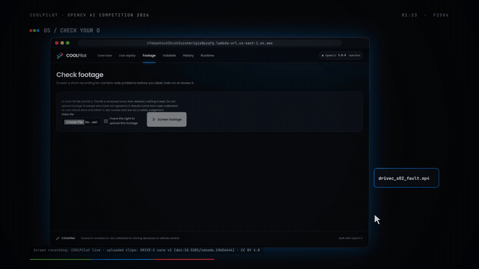<br><sub><strong>Check your own footage.</strong> Upload to S3, screened on Graviton, a report of what went wrong and when; the file is deleted after.</sub></td>
  </tr>
  <tr>
    <td width="50%">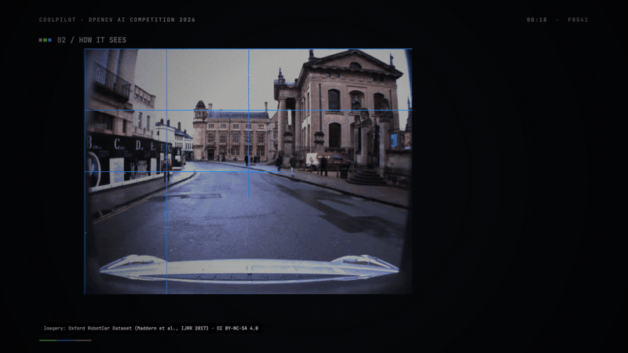<br><sub><strong>How it sees.</strong> 16 tiles, each against its own normal band; one drifts into a suspicion.</sub></td>
    <td width="50%">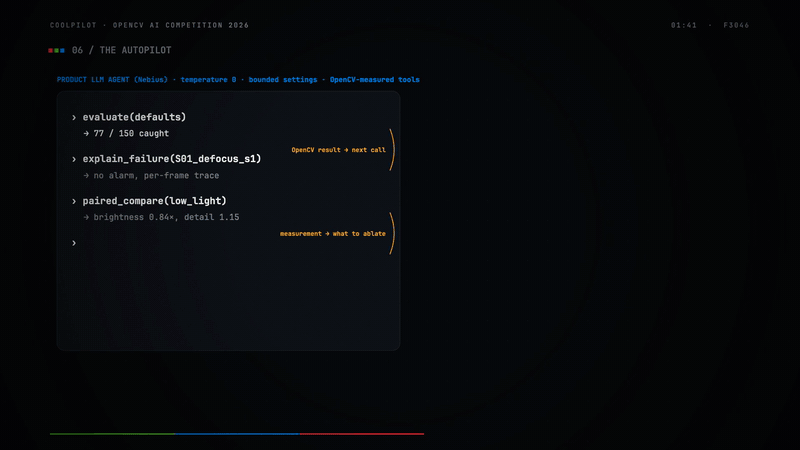<br><sub><strong>The autopilot.</strong> OpenCV-measured diagnosis, then a proposal, human approval, validation on unseen clips, and <em>NOT SHIPPED</em>.</sub></td>
  </tr>
</table>

| Overview | Live replay | Verifier verdict |
| --- | --- | --- |
| 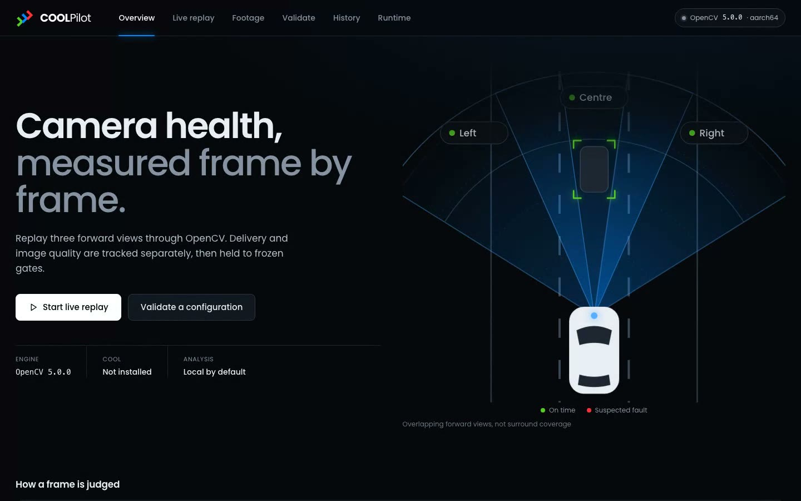 | 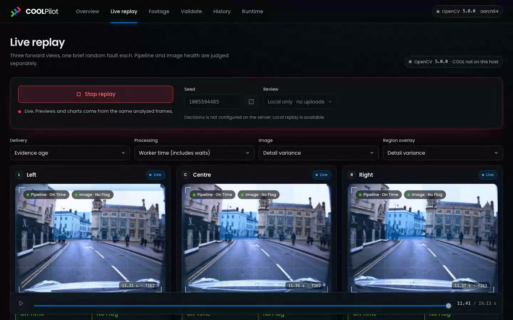 | 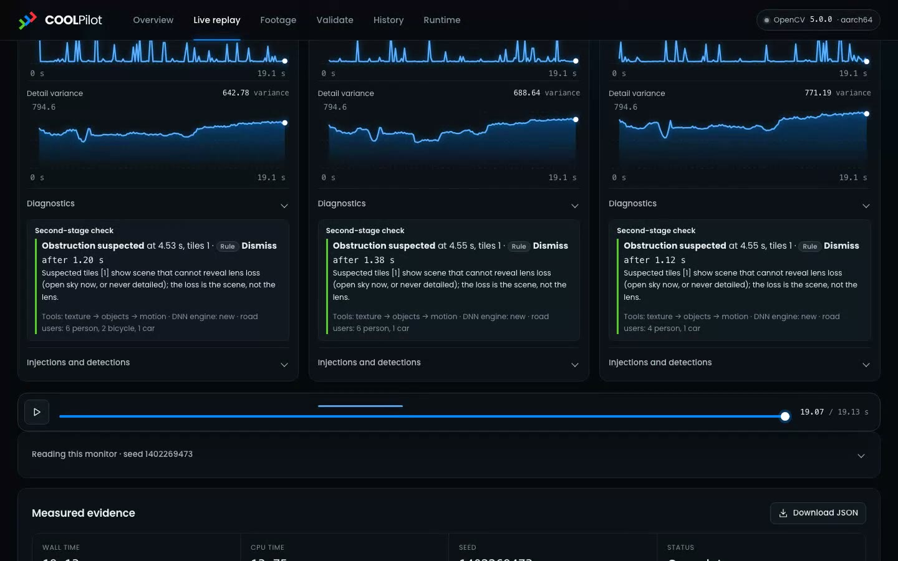 |

| Footage report: blackout found | Night footage, not a fault | AWS-measured run history |
| --- | --- | --- |
| 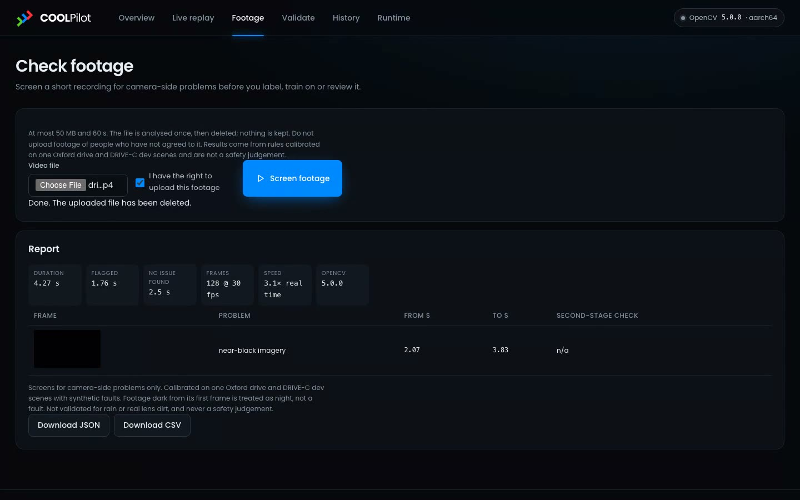 | 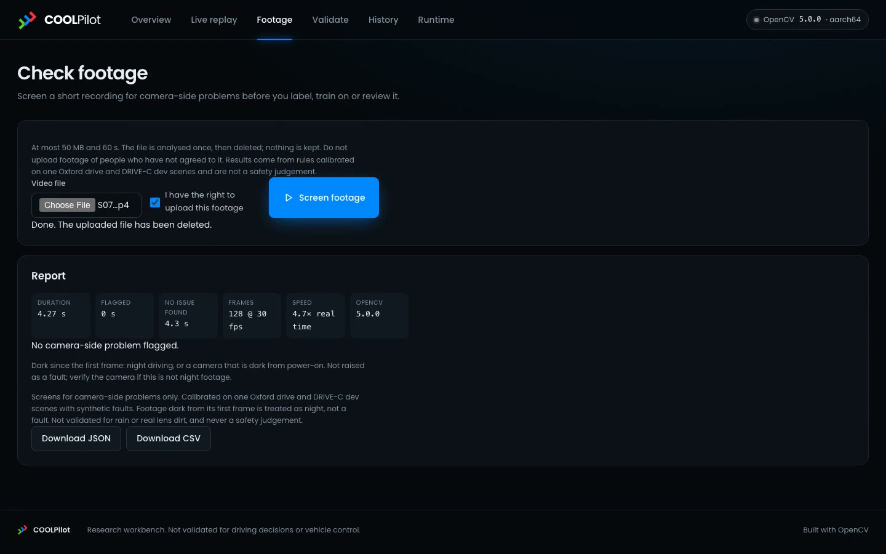 | 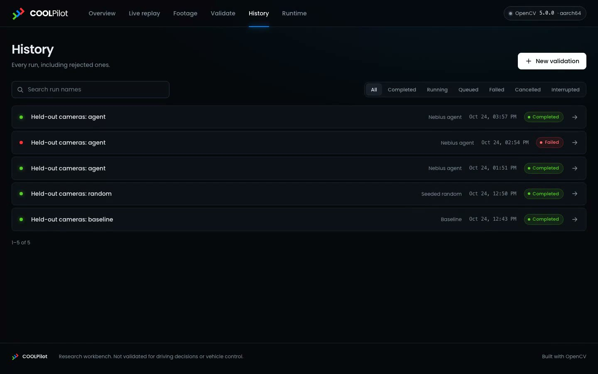 |

## 📊 Results

| What | Before | After | Evidence |
| --- | --- | --- | --- |
| False alarms/h, 42 never-inspected clips | 232 (detector) | **0 with the verifier**, no real fault lost | `docs/evidence/aws/verify-*fresh*.json` |
| Same, paced in real time on Graviton | 233.8 | **0.0** (+17% CPU) | `docs/evidence/aws/paced-fresh-*.json` |
| Fault checks failed, unseen cameras | 12 / 18 | **5 / 18** | `docs/evidence/calibration/` |
| Two more never-inspected Oxford sets | n/a | 4 / 18 failed each, **0 false alarms/h** | `docs/evidence/tuning/validation3/`, `validation4/` |
| DRIVE-C test, day / night (independent benchmark, now *seen*) | 13 / 60 · 0 / 90 | **28 / 60 · 29 / 90** | `docs/evidence/tuning/validation2/`, `validation3/` |
| Analysis cost on Graviton | n/a | ~3.5 ms / frame · ~30 cameras per c6g.2xlarge · **$9.07 per 1,000 camera-hours** | `docs/evidence/cool/` |

## OpenCV 5, measured

<p align="center">
  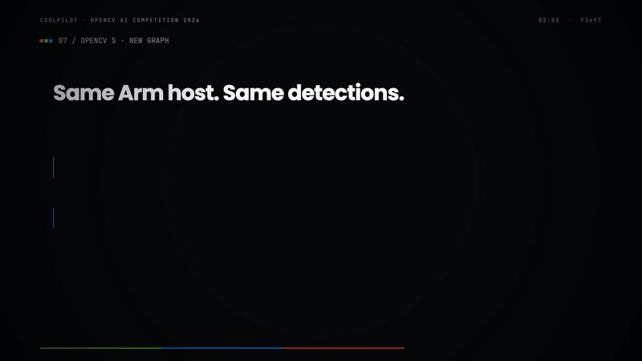
</p>

| Same Graviton2 host (c6g.2xlarge), identical detections (4.92 per frame) | OpenCV 4.12 | **OpenCV 5.0** | Gain |
| --- | --- | --- | --- |
| NanoDet road-user detector, 8 threads | 56.0 ms (classic engine) | **14.7 ms** (new graph engine) | **3.8×** |
| NanoDet, 1 thread | 94.5 ms | **68.9 ms** | 1.37× |
| Video decode (CPU-s, 3 clips) | 5.15 | **2.20** | 2.3× |
| Real-time cameras per instance | 27 | **30** | +11% |

## COOL on AWS Graviton

<table>
  <tr>
    <td width="50%">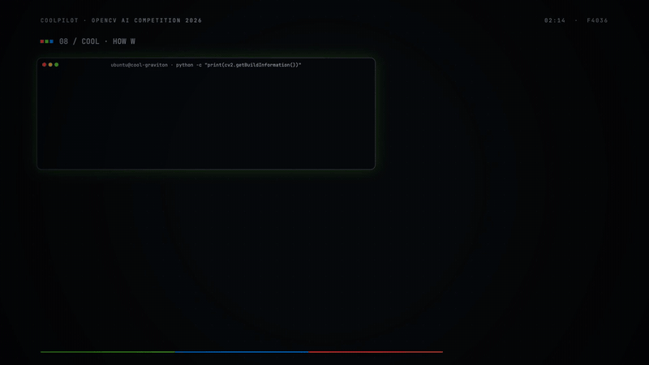<br><sub><strong>Configured.</strong> Verbatim output from the COOL instance, then the three steps we used.</sub></td>
    <td width="50%">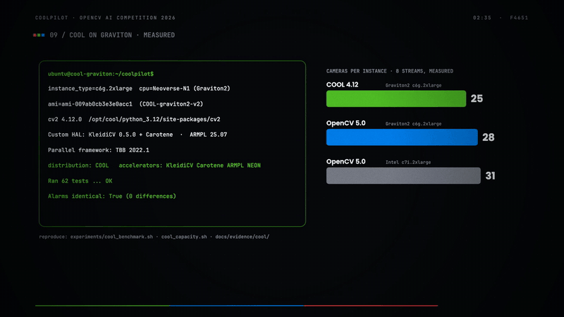<br><sub><strong>Measured.</strong> 8 parallel streams per instance, cost from the AWS Pricing API.</sub></td>
  </tr>
</table>

| Instance and build (8 streams, measured) | Real-time cameras | CPU | Analysis p95 | $ / 1,000 camera-hours |
| --- | --- | --- | --- | --- |
| c6g.2xlarge Graviton2, **COOL 4.12** (KleidiCV 0.5.0, ARMPL 25.07, TBB) | 27 | 98.9% | **18.5 ms** | 10.07 |
| c6g.2xlarge Graviton2, **OpenCV 5.0** | 30 | 98.8% | 21.6 ms | **9.07** |
| c7i.2xlarge Intel (x86), OpenCV 5.0 | 33 | 98.6% | 20.0 ms | 10.82 |

**What the measurements showed:**
- COOL **executed the whole workload**: the app reported `distribution: COOL`, all 62 tests passed, and the alarms were identical to the standard 4.12 wheel.
- COOL gave the **steadiest latency under load**.
- **Arm is the cheapest per camera**: 16% below x86.
- **The pilot's decision: standard OpenCV 5 on Graviton.** Decode is outside COOL's acceleration, and this COOL image is OpenCV 4.12, without OpenCV 5's DNN engine.

Full method and evidence: [docs/COOL.md](docs/COOL.md).

## The autopilot, and why nothing ships without proof

The diagnostic autopilot (`experiments/autopilot.py`) is the product's own LLM agent (Nebius, temperature 0). It is not the coding assistant that helped write this repository.

**The loop:**
1. It calls OpenCV-measured tools: `evaluate`, `explain_failure`, `paired_compare`, `ablate`.
2. Each result chooses its next call.
3. It ends in `propose`, which stays **pending human approval**.

**Its record so far:**
- **Its best proposal looked great:** 77 → 101 of 150 clips caught on tuning data.
- **Validation rejected it:** on clips nobody had seen, verifier false alarms rose from 0 to 32.5 per hour, so it was **never shipped**.
- **It did not beat random search** at the same budget. We report that too.

Step-by-step traces and the agent diagram: [docs/AGENT_WORKFLOW.md](docs/AGENT_WORKFLOW.md).

## How the system is built

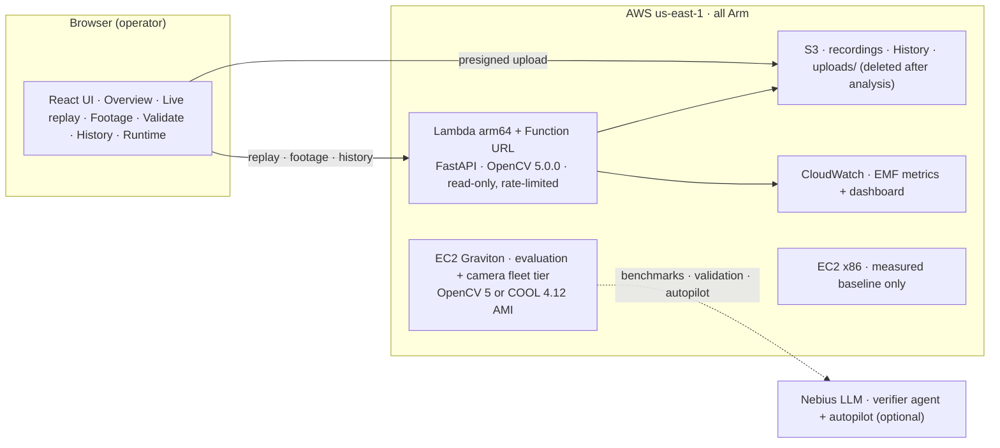

| Layer | What runs | Where |
| --- | --- | --- |
| Detector | `coolpilot/camera_health.py`: tile statistics, per-camera references, rules | Every replay, live camera and footage check |
| Verifier (Loop A) | `coolpilot/verify.py` (rule), `verify_agent.py` (LLM), `objects.py` (NanoDet, OpenCV 5 DNN) | Inside the replay and the footage gate |
| Autopilot (Loop B) | `experiments/autopilot.py`, `joint_calibrate.py` | EC2 Graviton, offline |
| Serving | `coolpilot/api.py` (FastAPI), `web/` (React) | Lambda arm64 + S3 + DynamoDB rate table |
| Evaluation | `experiments/` (calibrate, verify_eval, drivec_eval, cool_benchmark, cool_capacity) | EC2 Graviton, x86 baseline |

## 🛠 Run locally

```sh
docker compose up -d --build --wait          # http://127.0.0.1:8769
# or, without Docker
python -m venv .venv && . .venv/bin/activate && pip install -r requirements.txt
cd web && npm ci && npm run build && cd ..
uvicorn coolpilot.api:app --port 8769
```

- **Keys:** copy `.env.example` to `.env` (`chmod 600`). Local replay needs no keys. `NEBIUS_*` is only for the LLM agent arms.
- **Data:** the NanoDet model goes in `data/models/`, and the Oxford recordings in `data/oxford_robotcar/`.
- **Full operator guide:** [docs/DEVELOPER.md](docs/DEVELOPER.md).

## Verify

```sh
python -m unittest discover -s tests                                   # 62 tests
python -m experiments.calibrate --dataset oxford-camera-holdout --split validation --defaults
python -m experiments.verify_eval --dataset oxford-camera-holdout-fresh --arms none rule
bash experiments/cool_benchmark.sh && bash experiments/cool_capacity.sh cool standard   # on a COOL AMI
```

Held-out data is never read while tuning. Datasets are content-hashed. Every place that rule was bent (a seen test split) is labelled in [docs/BEFORE_AFTER.md](docs/BEFORE_AFTER.md).

## Truth boundaries

- **Lens dirt and occlusion:** not solved. 0/6 on Oxford holdouts, 0/25 on DRIVE-C.
- **Night:** 29/90. One of the 3 clean night scenes still alarms. A camera dark from power-on is not flagged; the report says "dark since the first frame, verify".
- **Glare** is caught 1–2 of 3 times per holdout. Mild defocus and mild underexposure are missed.
- **The LLM verifier** is worse than the fixed rule (99.6 vs 0 false alarms/h) and not reproducible across runs, so the rule is the default. The autopilot did not beat random search.
- **COOL** brought no speedup for this pipeline; we report the measured result, not a claim.
- **Data:** synthetic faults on one Oxford drive, plus DRIVE-C's 10 scenes. This is not road-safety evidence.

## Repository map

```text
coolpilot/            detector, verifier (rule + agent), NanoDet, footage gate, API, live source, metrics
web/                  React + TypeScript UI
experiments/          calibration, joint tuning, autopilot, verifier eval, DRIVE-C eval, COOL benchmark + capacity
scripts/              raw Oxford Bayer -> demosaic -> labelled synthetic faults; dataset builders
deploy/aws/           EC2 (standard or COOL AMI) and Lambda deployment
docs/                 technical report, agent workflow, COOL, before/after, evaluation, evidence/
video/                the showreel (deterministic canvas renderer, narration, score)
submission/           submission description, GIFs, screenshots
tests/                62 unit tests
```

## License and attribution

- **Code:** Apache-2.0 ([LICENSE](LICENSE)).
- **Oxford RobotCar Dataset:** W. Maddern, G. Pascoe, C. Linegar and P. Newman, *1 Year, 1000 km: The Oxford RobotCar Dataset*, IJRR 36(1), 2017. CC BY-NC-SA 4.0. The synthetic faults are ours.
- **DRIVE-C core v1:** Shiva Aher, Georgia Institute of Technology, doi:10.5281/zenodo.19656444. CC BY 4.0.
- **NanoDet-Plus:** OpenCV model zoo, Apache-2.0.
- **Showreel narration:** Qwen3-TTS (local).
