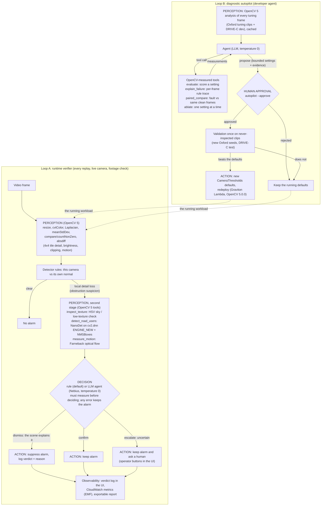

# Agent workflow: perception, decision, action

COOLPilot has two agent loops. In both, OpenCV 5 measurements decide what happens next:

- **Loop A, runtime verifier:** every live replay, live camera session and footage check.
- **Loop B, diagnostic autopilot:** a developer agent that tunes the detector.

Every number below comes from a recorded run; the files are listed with each trace.

## Diagram

Where it lives:
- **Loop A:** `coolpilot/camera_health.py` (perception and rules), `coolpilot/verify.py` (tools and rule decision), `coolpilot/verify_agent.py` (LLM decision), `coolpilot/objects.py` (NanoDet on the OpenCV 5 DNN engine).
- **Loop B:** `experiments/autopilot.py`. The earlier configuration agent, which also searches processing settings, is `coolpilot/agent.py`.

## Trace A: the autopilot changes its next call because of OpenCV output

Recorded on 2026-10-25, Graviton t4g.small, OpenCV 5.0.0. Budget: 16 evaluations. Wall time: 189.5 s. File: `docs/evidence/autopilot/tools.json`, field `trace`.

| Step | Tool call | OpenCV-measured result | What it changed next |
|---|---|---|---|
| 0 | `evaluate({})` (current defaults) | 77 of 150 DRIVE-C dev fault clips caught, 0 false alarms, Oxford 0 failed. Weakest: defocus 3/25, low light 11/25 | Starts diagnosing a weak class instead of guessing |
| 1 | `explain_failure("S01_defocus_blur_s1")` | No alarm. Per-frame log detail ratio around onset swings between −0.34 and +0.17, while this camera's learned normal swing is about 0.17 | Asks what the faults actually do to the measurements |
| 2–5 | `paired_compare` for defocus, lens occlusion, low light, underexposure | Defocus s1–s3 keep **0.97–1.00** of clean detail (invisible), s5 keeps 0.41. Low light s1 is only **0.84×** as bright. Underexposure s1 **0.90×**. Occlusion: the 4th-lowest tile drops to 0.16 at s5 | Mild darkening is the gap: brightness drops of 10–20% are missed by the fixed 0.65 ratio. So it tests the self-calibrating limit |
| 6 | `ablate("adaptive_k", [0, 1, 2, 3, 4])` | k=0: **77**, 0 FA · k=1: 86, **31 FA** · k=2: 86, **31 FA** · k=3: **101, 0 FA** · k=4: 91, 0 FA | Picks k = 3 and then checks the floor next to it |
| 7 | `ablate("adaptive_floor_dark", [0.05 … 0.25])` | 0.05: 62, 62 FA · 0.10: 84, 31 FA · 0.15: 82, 31 FA · **0.20: 101, 0 FA** · 0.25: 95 | Keeps floor 0.20 and moves on to the blur floor |
| 8 | `ablate("adaptive_floor_blur", …)` | Used the last 4 evaluations (16 of 16), then hit the limit on its 5th value. A bug in our tool discarded those 4 results and returned only "Evaluation budget exhausted". The tool now returns partial results | The agent never saw the blur-floor measurements |
| 9–17 | `ablate("adaptive_floor_blur", …)` ×9 | "Evaluation budget exhausted. Call propose." | Wasted turns: the agent repeated the call instead of proposing |
| 18 | `propose({adaptive_k: 3, floors 0.20 / 0.40, …})` | Scored outside the budget: **101/150**, 0 false alarms, low light 23/25, underexposure 21/25, defocus 9/25 | Written as **pending human approval**, so nothing is applied |

**What happened after the proposal (failure handling and human control):**
- The proposal was validated once on **fresh2**, Oxford clips nobody had inspected. Verifier-checked false alarms rose from **0 to 32.5 per hour**: the self-calibrated blur limit fired on glare's washed-out detail. On DRIVE-C test, day clips dropped from 28 to 18 of 60.
- It was **never approved**, so the running site kept its defaults.
- A narrower follow-up (self-calibrating brightness, blur never looser) **tied** the defaults on fresh3, a second never-inspected set, so it was not shipped either. Details: `docs/BEFORE_AFTER.md` section 6c.
- Honest comparison at the same budget: the `evaluate`-only agent reached 102/150, and random search reached 103, 100 and 83. **The diagnostic tools did not beat random search.** The value shown here is the loop itself (OpenCV output, then the next call, then the human gate, then validation), not a better optimiser.

Reproduce: `python -m experiments.autopilot --cache cache.pkl --arm tools --budget 16 --out tools.json` (needs `NEBIUS_*` in the environment), then `python -m experiments.autopilot --approve tools.json`.

## Trace B: the verifier decides with OpenCV evidence, at one recorded moment

Recorded on Graviton, OpenCV 5.0.0, on the never-inspected `oxford-camera-holdout-fresh` clips (unpaced, every frame). File: `docs/evidence/aws/verify-oxford-camera-holdout-fresh-validation.json`, clip `left_s1101_glare` at **4.06 s**. Ground truth at that moment: **no fault**. The glare in this clip starts later.

| Step | Loop A stage | Recorded value |
|---|---|---|
| 1 | Perception: tile statistics | Tile 1's detail fell below 35% of its own recent normal while the rest of the view kept its detail, for 0.5 s (the obstruction rule at that time). The **obstruction suspicion** fires on tile 1 |
| 2 | Tool `inspect_texture` (HSV) | Tile 1 relative texture 0.812, brightness **1.72×** the median tile, saturation **0.1**: open sky |
| 3 | Tool `detect_road_users` (NanoDet, `cv2.dnn` new engine) | Road users cover **0%** of tile 1 (the limit is 40%) |
| 4 | Tool `measure_motion` (Farneback) | Tile 1 flow **0.0 px**, other tiles median **5.75 px**: the tile is static |
| 5a | Decision, **rule** (default) | **dismiss**: "Suspected tiles [1] show scene that cannot reveal lens loss (open sky now, or never detailed); the loss is the scene, not the lens." Latency 0.21 s |
| 5b | Decision, **LLM agent** (same evidence) | **escalate** to a human. It quoted every measurement above ("open sky… scene-driven, not lens-related… 0% coverage… 0.0 px flow while other tiles 5.75 px…") yet still asked for a person. Tool order: `inspect_texture` → `detect_road_users` → `measure_motion` → `decide`. Latency 6.2 s |
| 6 | Action | Rule: the alarm is suppressed and the verdict logged. Agent: the alarm is kept and the operator's Confirm / Dismiss buttons appear |

**The same comparison over all 43 suspicions on these 42 never-inspected clips:**

| Arm | False alarms/h | Fault checks failed | Decisions | Median latency |
|---|---|---|---|---|
| No verifier | 232.4 | 11/36 | n/a | n/a |
| **Rule (default)** | **0.0** | 11/36 | 43 dismiss | 0.13 s |
| LLM agent | 99.6 | 11/36 | 25 dismiss, 18 escalate | 2.9 s |

- 41 of the 43 suspicions were scene (sky), not lens.
- The rule also dismissed 2 suspicions that fell inside a real obstruction interval. Obstruction detection is 0 of 6 with or without the verifier, so nothing was lost there, but the verifier cannot rescue it either.
- The agent is the human-in-the-loop option: slower, more cautious, and it escalates instead of silencing.
- Paced in real time on Graviton (`docs/evidence/aws/paced-fresh-{off,rule}.summary.json`): 233.8 → **0.0** false alarms/h, no real fault lost, +17% CPU.

Reproduce: `python -m experiments.verify_eval --dataset oxford-camera-holdout-fresh --split validation --arms none rule agent --out verify.json`.

## Evaluation summary (Agentic Vision evidence)

| Criterion | Evidence |
|---|---|
| **Task success** | Loop A removes the dominant false-alarm cause: 232 → 0 per hour on 42 never-inspected clips, and 233.8 → 0 paced on Graviton, with identical fault detection. Loop B reached 101/150 on tuning data but failed unbiased validation (see failure handling) |
| **Failure handling** | Loop A is fail-safe: any provider or tool error keeps the alarm; `decide` before any measurement is refused; reasons over 600 characters are truncated. Loop B: two tuning proposals failed validation and were rejected (`BEFORE_AFTER.md` 6b–6c); budget exhaustion and invalid tool calls return errors instead of acting |
| **Observability** | Per-decision verdict, reason, tools and latency (UI verdict log and JSON); CloudWatch EMF metrics and a `coolpilot` dashboard; full autopilot traces in `docs/evidence/autopilot/` |
| **Human control** | Loop A: escalations surface Confirm / Dismiss for an operator. Loop B: proposals stay `pending_human_approval` until `--approve`; shipping a setting with a cost (the night policy) was a user decision |
| **Honest limits** | The LLM verifier is worse than the fixed rule (99.6 vs 0 false alarms/h) and not reproducible across runs. The autopilot did not beat random search. Neither loop solves lens occlusion |
