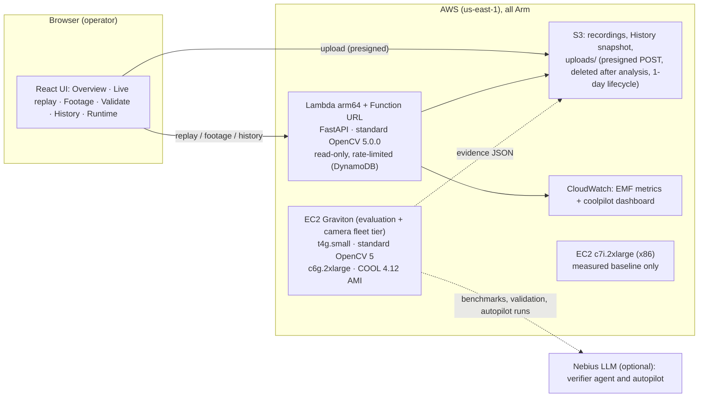

# COOLPilot: technical report

**What it is.** A camera-health workbench for ADAS camera fleets. OpenCV 5 checks every frame of every camera against that camera's own normal. An agent verifies suspicions with more OpenCV 5 tools before an alarm stands. A diagnostic autopilot tunes the detector, but nothing it proposes ships without fresh evidence and a human. It runs on AWS Graviton.

**What it is not.** It is not a safety system, and it is not validated on real lens dirt or rain. All faults in the evidence are synthetic, except for the independent DRIVE-C corruptions.

- **Live (read-only):** https://n7ebpehiuh2hczk2uzsherigia0pyqfg.lambda-url.us-east-1.on.aws/
- **Code:** `github.com/azharizz/coolpilot`

Every number below links to an evidence file in `docs/evidence/`.

## 1. Problem

A degraded camera rarely fails loudly: a smear, glare, a dark tunnel or a frozen frame still delivers frames. The starting detector used absolute thresholds, and they misfired on real scenes. A bright sky is always "clipped", so glare fired constantly.

Starting point, run #63:
- **15 of 53** gate checks failed.
- **1,332 false alarms per hour.**

Evidence: `evidence/run63-before.json`.

## 2. Architecture

- **Public endpoint:** serverless (Lambda arm64), using the standard OpenCV 5.0.0 wheel.
- **COOL:** ships as a Marketplace AMI, which Lambda cannot run. It therefore runs on EC2 Graviton, where evaluation and the camera-fleet tier also run.
- **x86:** appears only as a measured baseline. Nothing in the deployed system runs on x86.

## 3. How it works

**Detector** (`coolpilot/camera_health.py`). Each frame is resized and converted with OpenCV, and detail is measured at 640 px. It is split into 4×4 tiles. Each tile gets:
- brightness (`mean`)
- clipping (`compare` + `countNonZero`)
- detail (variance of `Laplacian`, via `meanStdDev`)

The frame thumbnail also feeds the freeze check (`absdiff`).

Rules compare each tile with the camera's own references, learned only while the view is healthy: glare, underexposure, blur, obstruction (the same tiles staying low while the rest keeps detail), blackout and freeze. They also apply hysteresis and persistence. A camera that is dark from its first frame is treated as its own normal (night).

**Loop A, runtime verifier** (`coolpilot/verify.py`, `verify_agent.py`). An obstruction suspicion triggers three OpenCV 5 tools:
- `inspect_texture`: HSV sky / low-texture check
- `detect_road_users`: NanoDet on the **OpenCV 5 `cv2.dnn` new engine**
- `measure_motion`: Farneback optical flow

A fixed rule (the default) or an LLM agent then **dismisses**, **confirms** or **escalates to a human**. It is fail-safe: any error keeps the alarm, and deciding before measuring is refused.

**Loop B, diagnostic autopilot** (`experiments/autopilot.py`). An LLM agent tunes bounded detector settings using OpenCV-measured tools:
- `evaluate`, `explain_failure` (per-frame rule trace), `paired_compare` (fault vs the same clean frames), `ablate`
- it ends with `propose`, which stays **pending human approval** and is validated once on never-inspected clips before anything changes

Diagram and step-by-step traces: [AGENT_WORKFLOW.md](AGENT_WORKFLOW.md).

## 4. Results

| What | Before | After | Evidence |
|---|---|---|---|
| Fault checks failed, unseen cameras (detector) | 12 / 18 | 5 / 18 | `evidence/calibration/` |
| False alarms/h, 42 never-inspected clips | 232 (detector) | **0 with the verifier**, no real fault lost (11/36 failed either way) | `evidence/aws/verify-*fresh*.json` |
| Same, paced in real time on Graviton | 233.8 | **0.0**, +17% CPU | `evidence/aws/paced-fresh-*.json` |
| Two more never-inspected Oxford sets (fresh2, fresh3) | n/a | 4/18 failed, 0 false alarms/h with the verifier | `evidence/tuning/validation3/`, `validation4/` |
| DRIVE-C test (independent benchmark; **seen** since one failed validation) | day 13/60, night 0/90 | day **28/60**, night **29/90** | `evidence/tuning/validation2/`, `validation3/` |
| OpenCV 5 new DNN engine vs 4.x classic (NanoDet) | 96.0 ms (4.13) | **71.9 ms** (Graviton t4g); 14.7 vs 56.0 ms at 8 threads (c6g) | `evidence/aws/dnn-*.json`, `evidence/cool/dnn-*.json` |

**Joint tuning on Oxford + DRIVE-C dev** (`BEFORE_AFTER.md` 6b–6c):
- The first freeze **failed** validation: DRIVE-C test day dropped 13 → 0/60. The two choices behind it were dropped, and the reasons are recorded.
- Self-calibrating limits and the autopilot's best proposal looked better on tuning data (77 → 101/150), then **added false alarms on unseen clips** (0 → 32.5/h). The approval gate kept them out.
- What shipped: detail measured at 640 px, a 1.2 s obstruction hold, and the night policy.

## 5. COOL on AWS Graviton

The COOL setup, from `COOL.md`:
- **AMI:** `COOL-graviton2-v2` (`ami-009ab0cb3e3e0acc1`) on a **c6g.2xlarge** (Neoverse-N1, 8 vCPU).
- **COOL build:** OpenCV 4.12.0 with KleidiCV 0.5.0 + Carotene, ARMPL 25.07, TBB.

**COOL ran the core workload:**
- the app's own runtime check reported `distribution: COOL`
- all 62 tests passed
- the service ran under it
- measurements and alarms were identical to the standard 4.12 wheel

**Capacity, measured** (8 parallel camera streams, production pipeline; on-demand prices from the AWS Pricing API):

| Instance and build | Frames/s | Real-time cameras | CPU | Analysis p95 | $ per 1,000 camera-hours |
|---|---|---|---|---|---|
| c6g.2xlarge, COOL 4.12 | 387 | 27 | 98.9% | 18.5 ms | 10.07 |
| c6g.2xlarge, OpenCV 5.0 | 440 | 30 | 98.8% | 21.6 ms | **9.07** |
| c7i.2xlarge (x86), OpenCV 5.0 | 484 | 33 | 98.6% | 20.0 ms | 10.82 |

**Decision: standard OpenCV 5 on Graviton.** Arm is 16% cheaper per camera than x86. COOL brings no gain for this pipeline, for three reasons:
- decoding is about a third of the CPU, and it is outside COOL's acceleration
- our heaviest calls are not on the KleidiCV list
- this COOL image is OpenCV 4.12, without OpenCV 5's DNN engine

Reproduce with `experiments/cool_benchmark.sh` and `experiments/cool_capacity.sh`.

## 6. Limits and failures (stated, not hidden)

- **Lens dirt and occlusion:** 0/6 on Oxford holdouts, 0/25 on DRIVE-C. The tile statistics cannot separate it from scene change without false alarms.
- **Night:** 29/90. One of the 3 clean night scenes still alarms. A camera dark from power-on is not flagged; the report says "verify".
- **Glare:** 1–2 of 3 per holdout. **Mild defocus and underexposure:** missed.
- **The autopilot did not beat random search** at the same budget. The LLM verifier is worse than the fixed rule (99.6 vs 0 false alarms/h) and not reproducible across runs, so the rule is the default.
- **Data:** one Oxford drive plus DRIVE-C's 10 scenes, all synthetic faults. Five daytime dev scenes were too few to select rules, which we learned from the failed validations.

## 7. Reproducibility and responsible operation

- **Pinned dependencies:** `requirements.txt`, with OpenCV 5.0.0.93 and NumPy 2.5.3.
- **Tests:** 62, passing on Mac, Graviton (standard and COOL) and x86.
- **Re-running the evaluations:** every script is in `experiments/` and `deploy/aws/`, with commands in the README and `BEFORE_AFTER.md`. Datasets are content-hashed. Held-out data is never read during tuning, and every time that rule was bent (a seen test split) it is labelled.
- **Uploads:** footage is deleted right after analysis. Users must confirm they have the right to upload.
- **The public site:** read-only and rate-limited. LLM keys are never sent to benchmark subprocesses.
- **Evidence:** per-run JSON, CloudWatch metrics and agent traces.
