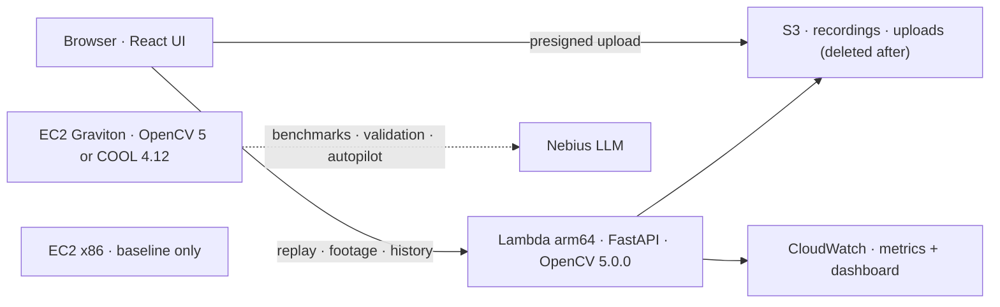

  

# COOLPilot

## A dirty lens doesn't crash. It quietly lies. COOLPilot catches it.

**COOLPilot** is camera health for ADAS fleets:
- **OpenCV 5 checks every frame** of every camera against *that camera's own normal*.
- **An agent verifies** each suspicion with more OpenCV 5 tools before an alarm stands.
- **A diagnostic autopilot tunes the detector**, and nothing it proposes ships without fresh evidence and a human.

It runs live on **AWS Graviton**. We also measured it on COOL, the Cloud-Optimized OpenCV Library, against standard OpenCV 5 and against x86.

  
  
  

  
  
  
  
  

  

## Inspiration

Cameras are how a car sees, and they fail quietly. Mud on the lens, sun glare, a tunnel or a frozen feed: the frames keep coming, so everything downstream keeps trusting them.

We tried the obvious fix first: fixed thresholds. It failed immediately on real roads:
- A bright sky is always "clipped", so our glare alarm fired all day.
- A building sliding past made the road look "obstructed".

Our own first version failed **15 of 53** checks at **1,332 false alarms an hour**. An alarm nobody can trust is worse than no alarm.

So we asked a narrower question: *can every camera be judged against its own normal, frame by frame, and can an alarm be trusted because something measured it twice?*

  

## What it does

| COOLPilot capability | What it does | Why it matters |
| --- | --- | --- |
| **1 · Every camera vs its own normal** | OpenCV 5 splits every frame into 16 tiles: detail, brightness, clipping and freeze. Each tile is compared with references learned while *that* camera looked healthy. | A bright sky stops being "glare". A sudden one is. |
| **2 · An agent measures twice** | A suspected obstruction triggers OpenCV 5 tools: texture (HSV), road users (NanoDet on the **new `cv2.dnn` graph engine**) and motion (Farneback flow). It then dismisses, keeps, or asks a human. | **232 → 0 false alarms per hour** on 42 never-inspected clips, with no real fault lost. |
| **3 · Live, on Graviton** | Three cameras replayed at their real sensor timing on AWS Lambda arm64. Delivery health (late, missing) is judged separately from image health. | "Late" is not "broken". Result age ≤ 0.25 s. |
| **4 · Check your own footage** | Upload a clip (presigned S3) and get a report of what went wrong and when. The file is deleted after analysis. Night footage is treated as night. | A camera-data quality gate before labelling or training. |
| **5 · A diagnostic autopilot** | An LLM agent tunes the detector with OpenCV-measured tools, then proposes. A human approves, and validation on never-seen clips decides. | It found a "better" setting that **failed** unseen data, and the gate kept it out. |
| **6 · Measured on COOL vs OpenCV 5 vs x86** | The same workload on the COOL Graviton AMI, on standard OpenCV 5, and on Intel, at 8 parallel streams. | The pilot picks the cheapest safe stack: **OpenCV 5 on Graviton, $9.07 per 1,000 camera-hours**. |

## Product walkthrough

<table>
  <tr>
    <td width="50%"> <strong>I · How it sees.</strong> 16 tiles, each against its own normal band. One drifts, and that's a suspicion, not yet an alarm.</td>
    <td width="50%"> <strong>II · Live on AWS Graviton.</strong> The real deployed app: Start replay, three cameras streaming, glare caught on the centre one.</td>
  </tr>
  <tr>
    <td width="50%"> <strong>III · The agent measures before it decides.</strong> Open sky, 0% road users, 0.0 px motion: the scene, not the lens. <em>Dismissed.</em></td>
    <td width="50%"> <strong>IV · The loop.</strong> Perception (OpenCV 5), decision (rule or LLM agent, fail-safe), action (dismiss, keep, ask a human), all observable.</td>
  </tr>
  <tr>
    <td width="50%"> <strong>V · Check your own footage.</strong> Upload, screened on Graviton, blackout found at 2.07–3.83 s; night clip flagged "dark since the first frame".</td>
    <td width="50%"> <strong>VI · Nothing ships without proof.</strong> Diagnose, ablate, propose, human approval, unseen validation, <em>NOT SHIPPED</em>.</td>
  </tr>
</table>

| Overview | Live replay | Verifier verdict |
| --- | --- | --- |
|  |  |  |

| Footage report | Night, not a fault | Runs measured on AWS |
| --- | --- | --- |
|  |  |  |

Screenshots and clips are recordings of the deployed app. Road imagery: Oxford RobotCar (CC BY-NC-SA 4.0). Uploaded clips: DRIVE-C core v1 (CC BY 4.0).

## How we built it

**OpenCV 5 is the workload, not a wrapper.** Every stage is an OpenCV call:

| Stage | OpenCV 5 | Why this call |
| --- | --- | --- |
| Test feeds from raw sensors | `cvtColor(COLOR_BayerGBRG2BGR / BayerRGGB2BGR)` | Raw Oxford RobotCar Bayer frames, demosaiced, then given synthetic faults with frame-exact ground truth |
| Per-frame measurement | `resize(INTER_AREA)`, `cvtColor`, `Laplacian` + `meanStdDev`, `compare` + `countNonZero`, `absdiff` | Detail at 640 px (defocus is invisible at 320 px, measured), clipping, freeze |
| Verifier perception | `cvtColor(BGR2HSV)`, `dnn.readNetFromONNX(engine=ENGINE_NEW)`, `dnn.blobFromImage`, `dnn.NMSBoxes`, `calcOpticalFlowFarneback` | Sky and texture, road users (NanoDet-Plus), static-tile motion |
| Video in and out | `VideoCapture` (files, RTSP or USB live sources), `imencode` | Paced replay, live cameras, report thumbnails |

**OpenCV 5's speed-up, measured on the same Arm host, with identical detections:**

  

| c6g.2xlarge Graviton2 | OpenCV 4.12 | **OpenCV 5.0** | Gain |
| --- | --- | --- | --- |
| NanoDet, 8 threads | 56.0 ms (classic) | **14.7 ms** (new graph engine) | **3.8×** |
| NanoDet, 1 thread | 94.5 ms | **68.9 ms** | 1.37× |
| Video decode | 5.15 CPU-s | **2.20 CPU-s** | 2.3× |
| Real-time cameras per instance | 27 | **30** | +11% |

**The stack:**
- **Backend:** Python 3.12, FastAPI, pinned `opencv-python-headless==5.0.0.93` and NumPy 2.5.3.
- **UI:** React + TypeScript (Vite).
- **AWS:** Lambda arm64 behind a Function URL, S3 for recordings, History and presigned uploads, DynamoDB rate limiting, CloudWatch EMF metrics and a dashboard, EC2 Graviton for evaluation and the camera-fleet tier.
- **LLM:** Nebius at temperature 0, for the verifier agent and the autopilot.
- **Detector model:** NanoDet-Plus ONNX from the OpenCV model zoo.

## Agentic Vision: two loops where OpenCV 5 output changes what happens next

**Loop A, the runtime verifier.** OpenCV 5 tile statistics raise a suspicion. The agent calls OpenCV 5 tools, and **their measurements decide the action**: dismiss, keep, or escalate to a human.

It is fail-safe:
- Deciding before measuring is refused.
- Any error keeps the alarm.
- Reasons are capped at 600 characters.
- Every verdict is logged with its reason, tools and latency, and emitted to CloudWatch.

**Loop B, the diagnostic autopilot.** This is the *product's* LLM agent, not the coding assistant that helped write the repo.
- **It reads OpenCV measurements to choose its next call.** After `paired_compare` showed low light dims frames only to 0.84×, it ablated `adaptive_k` and found that k = 3 caught 101 of 150 clips.
- **It proposed that setting**, and the proposal waited for **human approval**.
- **Validation on never-seen clips then rejected it** (verifier false alarms 0 → 32.5 per hour), so it was **never shipped**. That is the failure handling working.

| Agentic evidence | Where |
| --- | --- |
| Workflow diagram (perception, decision, action, human, observability) | [AGENT_WORKFLOW.md](https://github.com/azharizz/coolpilot/blob/main/docs/AGENT_WORKFLOW.md) and the showreel |
| Step-by-step traces (autopilot run; one verifier moment judged by the rule and by the agent) | [AGENT_WORKFLOW.md](https://github.com/azharizz/coolpilot/blob/main/docs/AGENT_WORKFLOW.md), `docs/evidence/autopilot/` |
| Task success, failure handling, observability, human control | [TECHNICAL_REPORT.md](https://github.com/azharizz/coolpilot/blob/main/docs/TECHNICAL_REPORT.md) §4, §6 |

## COOL: measured on AWS Graviton, decided by the numbers

<table>
  <tr>
    <td width="50%"> <strong>How we configured it.</strong> Real output from the COOL instance: OpenCV 4.12.0, KleidiCV 0.5.0 + Carotene, ARMPL 25.07, TBB, then <code>distribution: COOL</code>.</td>
    <td width="50%"> <strong>What it measured.</strong> 8 streams per instance; prices from the AWS Pricing API.</td>
  </tr>
</table>

**Setup, in three steps:**
1. Launch `COOL-graviton2-v2` (`ami-009ab0cb3e3e0acc1`) on a c6g.2xlarge (Neoverse-N1).
2. Run on the vendor build: `PYTHONPATH=/opt/cool/python_3.12/site-packages`, `LD_LIBRARY_PATH=/opt/cool/cpp_sdk/lib`.
3. Use one OpenCV thread per camera stream. At 8 threads, COOL's TBB pool ran 0.84× on our small tiles.

COOL ran the whole workload: `distribution: COOL`, all 62 tests passing, and alarms identical to the standard 4.12 wheel.

| 8 parallel streams, measured | Real-time cameras | CPU | Analysis p95 | $ / 1,000 camera-hours |
| --- | --- | --- | --- | --- |
| Graviton2, **COOL 4.12** | 27 | 98.9% | **18.5 ms** (steadiest) | 10.07 |
| Graviton2, **OpenCV 5.0** | 30 | 98.8% | 21.6 ms | **9.07** |
| Intel c7i (x86), OpenCV 5.0 | 33 | 98.6% | 20.0 ms | 10.82 |

**What the numbers say:**
- **Arm wins on cost:** 16% cheaper per camera than x86.
- **COOL gives the steadiest latency under load**, but no throughput gain for this pipeline. Decode is outside its acceleration, and this AMI ships OpenCV 4.12, without the 5.0 DNN engine.
- **So the pilot chooses standard OpenCV 5 on Graviton.**
- Reproduce with `experiments/cool_benchmark.sh` and `cool_capacity.sh`. Evidence: `docs/evidence/cool/`.

## Challenges we ran into

- **Fixed thresholds lie on real roads.** We moved to per-camera references that learn only while the view is healthy, and freeze while anything is pending.
- **We overfit, twice, and caught it.** Tuning on five daytime DRIVE-C dev scenes produced settings that looked great on dev and broke on test (DRIVE-C test day dropped 13 → 0/60). We kept only changes with a measured mechanism, and labelled test data as *seen* from then on.
- **Defocus was invisible.** Comparing each fault clip with its clean original, frame by frame, showed our 320 px analysis scale erased exactly the detail that defocus removes. Measuring at 640 px fixed it.
- **Night looked like a broken camera.** A camera dark from its first frame is now its own normal. The trade-off (a camera dark from power-on is not flagged) is stated in every report.
- **COOL's real configuration** was not in the obvious place: the vendor `cv2` lives in `/opt/cool/python_3.12/site-packages`. We found it on the instance and fixed our setup script.

## Accomplishments we're proud of

- **232 → 0 false alarms per hour** on clips nobody had looked at, with no real fault lost, paced in real time on Graviton.
- **3.8× faster road-user detection** from OpenCV 5's new graph engine on the same Arm host, with identical detections.
- **An agentic system that says no to itself.** The autopilot's best idea failed unseen validation, and the human gate kept it out.
- **A real COOL measurement on AWS Graviton**, with an x86 baseline and cost per camera-hour.
- **Everything reproducible:** 62 tests, pinned dependencies, content-hashed datasets, and evidence JSON for every number.

## What we learned

- **A trustworthy alarm needs a second look.** Measuring twice, cheaply with OpenCV, beat any single smarter threshold.
- **Five scenes are not a validation set.** Fresh, never-inspected data is what tells you the truth.
- **Choosing the stack is measurement too.** The cheapest safe configuration was not the one with "optimized" in its name.

## What's next

- **Real soiled-lens data and a learned occlusion model.** Lens dirt is the open problem.
- **Exposure metadata from the camera ISP**, for honest night handling.
- **Wiring the autopilot's threads and streams search directly into COOL and Graviton deployments**, so it picks the cheapest safe configuration per fleet.

## Truth boundaries

- COOLPilot is a research workbench, not a safety system.
- All faults in the evidence are synthetic, except DRIVE-C's corruptions.
- Lens dirt is not solved, and night is 29/90.
- The LLM verifier is worse than the fixed rule, so the rule is the default.
- The autopilot did not beat random search.
- COOL brought no speedup for this pipeline.

## Built with

OpenCV 5.0 (`cv2.dnn` new graph engine) · COOL (Cloud-Optimized OpenCV Library) · KleidiCV · Arm Performance Libraries · AWS Graviton · AWS Lambda (arm64) · Amazon EC2 · Amazon S3 · Amazon DynamoDB · Amazon CloudWatch · Python · FastAPI · NumPy · React · TypeScript · Vite · NanoDet-Plus (ONNX) · Nebius AI · Qwen3-TTS · Oxford RobotCar Dataset · DRIVE-C

## Try it

- **Live (read-only, AWS Lambda arm64):** https://n7ebpehiuh2hczk2uzsherigia0pyqfg.lambda-url.us-east-1.on.aws/
- **Code:** https://github.com/azharizz/coolpilot
- **Technical report:** [TECHNICAL_REPORT.md](https://github.com/azharizz/coolpilot/blob/main/docs/TECHNICAL_REPORT.md)
- **Showreel:** `video/coolpilot_showreel_upload.mp4` (3:10)
